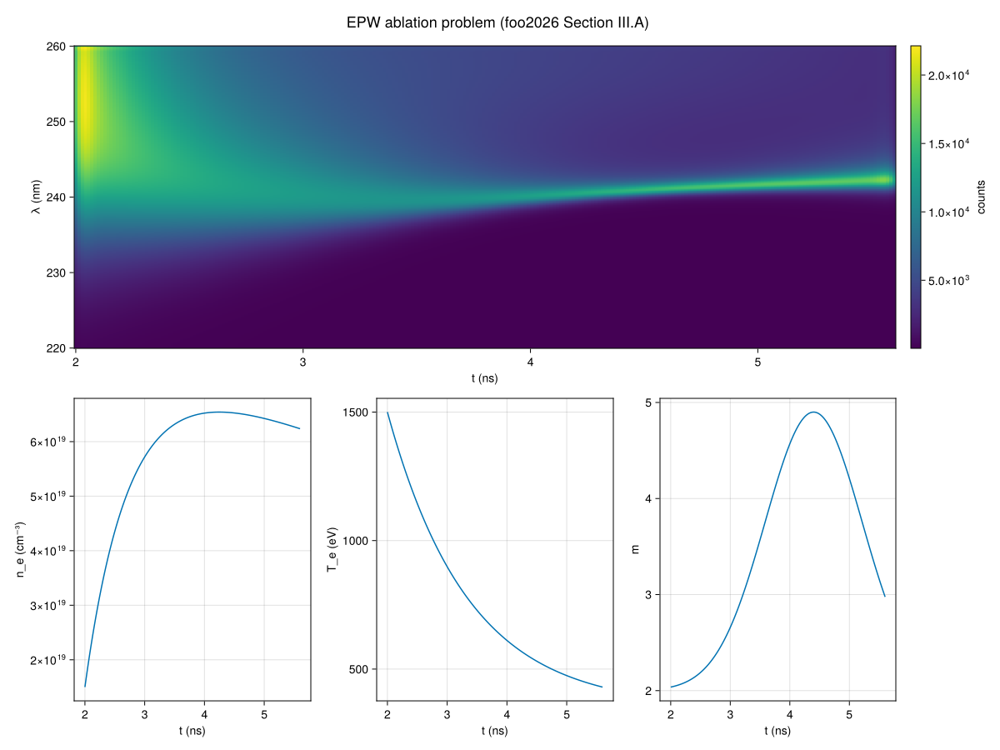
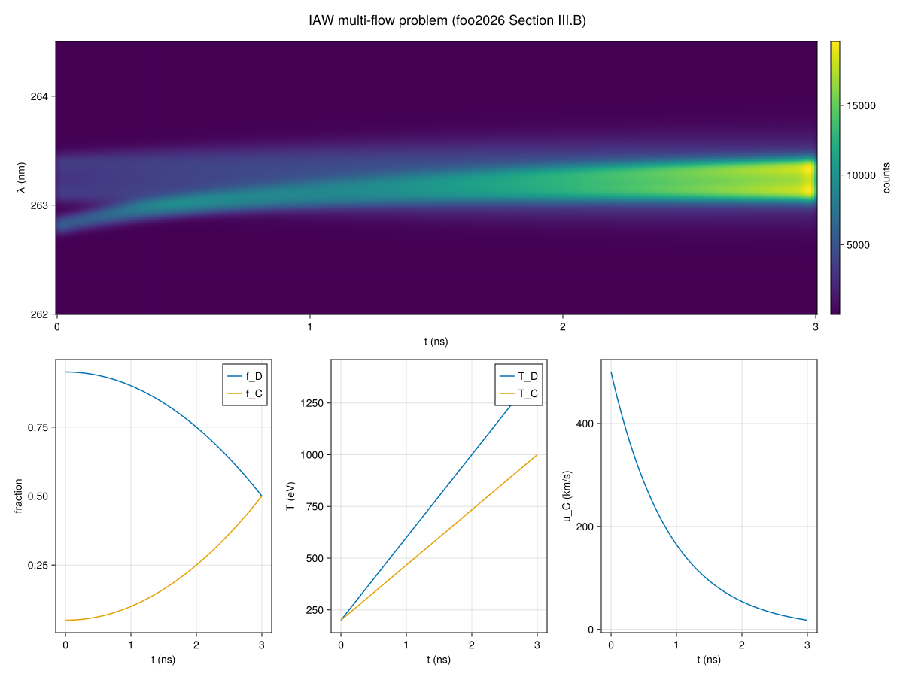
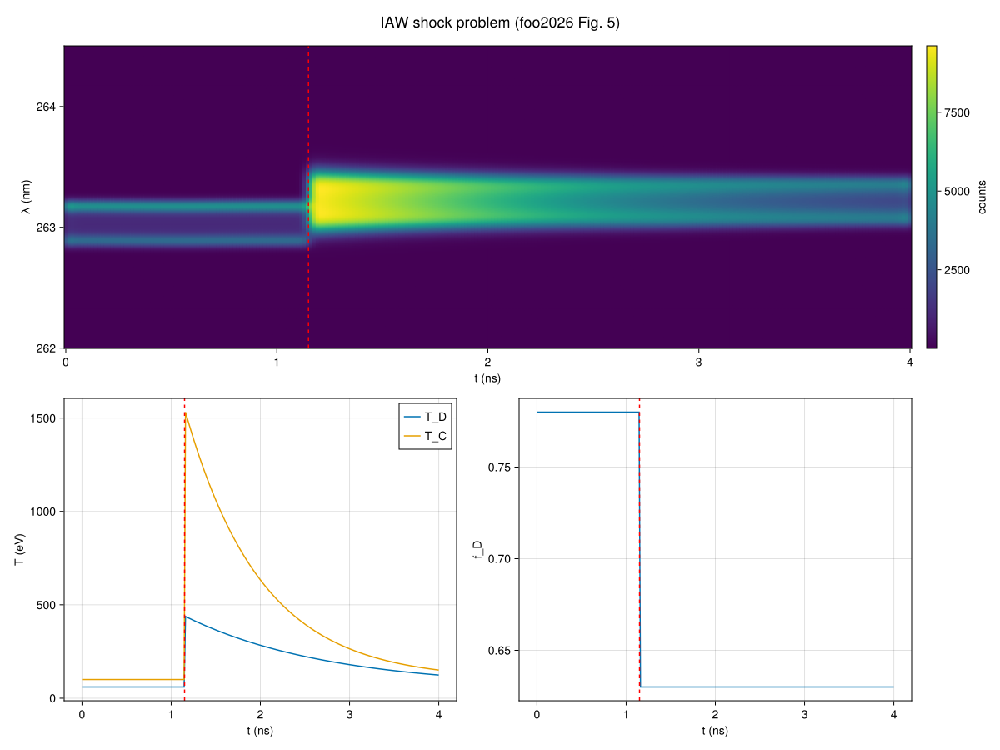
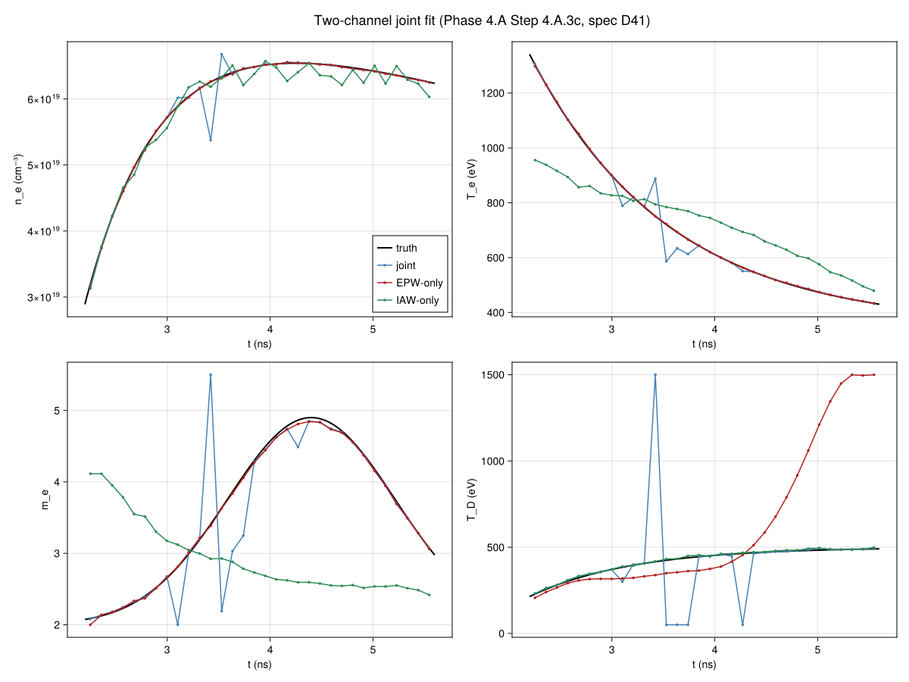
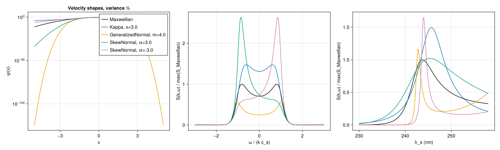

# Figure gallery

Five figures showing what OTIS.jl produces, drawn from the three test problems of foo2026
Section III at the full 512 × 256 resolution and the fixed seeds of `examples/problems.jl`.
They are regenerated by [`make_figures.jl`](make_figures.jl), never hand-edited.

## `epw_ablation.png`



The EPW ablation problem (foo2026 Fig. 3 top-left and Fig. 4 top): the noise-free measured
streak of the electron plasma wave feature as the density rises, the temperature falls and the
super-Gaussian exponent `m(t)` peaks mid-shot, with the three driving traces read straight off
the `PlasmaTrace` below it.

## `iaw_multiflow.png`



The interpenetrating-flow problem (foo2026 Fig. 3 bottom-left and Fig. 4 bottom): two ion-acoustic
features merging as the fast carbon flow decelerates and its fraction grows, with the deuteron
and carbon fractions, temperatures and the carbon flow speed below.

## `iaw_shock.png`



The shock problem (foo2026 Fig. 5), plus the streak the paper does not show: everything —
temperatures, the deuteron fraction, and the streak itself — jumps at the shock front,
`t_s = 1.15` ns, marked with a dashed line on every panel.

## `instrument_chain.png`

*No counterpart in foo2026.* One spectrum (bin 128 of 256 of the EPW problem, `t ≈ 3.8` ns)
plotted four times as the instrument chain is switched on one effect at a time, with a
difference-from-ideal panel below showing the size of what each effect changes: `KSmearing`
mainly steepens the wings, `SpectralIRF` mainly softens the peak, and `Sensitivity` with
`ConstantBackground` mainly lifts the floor.

## `noise.png`

*No counterpart in foo2026.* The streak-camera noise model of Swadling et al. (2022), otherwise
invisible in a heatmap: one column's expected signal, a noisy draw, and its `±σ` band on the
left; on the right, the standardized residual `(image − S̄)/σ` over the whole streak against the
unit normal. **The right panel uses `sigma_px = 0`** — with the point spread on, neighbouring
pixels are correlated and the per-pixel variance is smaller than `σ²`, which this package does not
model (OQ-14) — and it is visibly right-skewed rather than symmetric, because roughly a third of
the streak's pixels sit at or near the background level, where Poisson statistics are furthest
from Gaussian; both are the model behaving as documented, not a rendering artefact.

## `two_channel_fit.png`



*No counterpart in foo2026.* Phase 4.A Step 4.A.3c (spec D41): the synthetic two-channel problem
— the EPW ablation plasma plus a time-varying deuterium temperature, seen by an EPW camera
(220–260 nm, blind to `T_D`) and an IAW camera (262–264.5 nm, only weakly sensitive to `n_e`)
through one probe and one collection. Four panels (`n_e`, `T_e`, `m_e`, `T_D` against `t`), each
against the truth, for the joint fit and for each single-channel fit with every variable still
free: the EPW-only fit reproduces `n_e`, `T_e` and `m_e` but lets `T_D` wander to its bound; the
IAW-only fit reproduces `T_D` but lets `T_e` and `m_e` wander; the joint fit recovers all four.
**Generated separately from the five above**, by
[`make_two_channel_figure.jl`](make_two_channel_figure.jl), which reads the three result files
`examples/fit_two_channel.jl` writes (`runs/two_channel/{joint,epw,iaw}/result.jld2`) rather than
synthesizing anything itself — run `examples/two_channel.jl` and `examples/fit_two_channel.jl`
first. Not part of `make_figures.jl`/`FIGURE_NAMES` (FG1 asserts exactly five files).

## `shapes.png`



*No counterpart in foo2026.* Phase 4.B Step 4.B.5 (spec D40): `Kappa`, `GeneralizedNormal` and `SkewNormal` against the Maxwellian, and what each does to the IAW and EPW features, drawn by [`make_shapes_figure.jl`](make_shapes_figure.jl) — a physics figure, not part of `make_figures.jl` (FG1 asserts exactly five files).

## Regenerating

```
julia --project=examples/figures -e 'using Pkg; Pkg.develop(path="."); Pkg.instantiate()'
julia --project=examples/figures examples/figures/make_figures.jl
```

These five PNGs are committed and regenerated only when the physics, the profiles or the
plotting API change — not routinely, and never hand-edited (`conventions.md` 10.4).
`two_channel_fit.png` is regenerated the same way, but by its own script, after
`examples/fit_two_channel.jl` has written its three result files:

```
julia --project=. examples/two_channel.jl
julia --project=. examples/fit_two_channel.jl
julia --project=examples/figures examples/figures/make_two_channel_figure.jl
```
